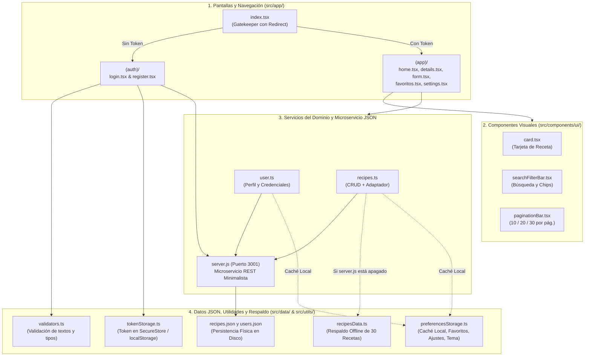

# Guía Maestra de Estudio y Defensa del Proyecto: React Native + GastroLab

Esta guía está diseñada para que domines **desde los conceptos más básicos de React Native** (basados en la [documentación oficial de React Native](https://reactnative.dev/docs/getting-started) y en el proyecto de clase del profesor [`ReactPractice-main`](file:///c:/Users/manue/Documents/React/ReactPractice-main/ReactPractice-main)) hasta el **funcionamiento exacto línea por línea** de **GastroLab**.

Además, incluye una sección especial de **"Preguntas Típicas del Profesor"** (*"¿Dónde cambio esto?"*, *"¿Qué pasa si borro esta línea?"*) y **Experimentos Prácticos** para que practiques antes de presentar.

---

## Parte 1: Los Cimientos de React Native (Lo Esencial desde Cero)

### 1.1 ¿Qué es React Native y en qué cambia respecto a una página Web?
Según la [documentación oficial de React Native](https://reactnative.dev/docs/getting-started), en lugar de usar etiquetas HTML (`<div>`, `<p>`, ``, `<input>`), en React Native construimos la interfaz usando **Core Components (Componentes Nucleares)**. React Native convierte esos componentes en vistas nativas reales de Android, iOS y Web.

| Si en HTML/Web usabas... | En React Native usamos... | ¿Para qué sirve en nuestra app? | Ejemplo real en nuestro código |
| :--- | :--- | :--- | :--- |
| `<div>` | **`<View>`** | Es una "caja" contenedora invisible que ordena elementos usando **Flexbox** (por defecto en columna vertical `flexDirection: 'column'`). | Contenedor de tarjetas y pantallas en [home.tsx](file:///c:/Users/manue/Documents/React/GastroLab/src/app/%28app%29/home.tsx#L233). |
| `<p>`, `<h1>`, `<span>` | **`<Text>`** | **Regla de oro:** En React Native, **ningún texto puede estar suelto** fuera de una etiqueta `<Text>`. Si pones texto directo dentro de un `<View>`, la app da error. | Títulos, descripciones e insignias en [card.tsx](file:///c:/Users/manue/Documents/React/GastroLab/src/components/ui/card.tsx#L116-L127). |
| `` | **`<Image>`** | Muestra imágenes locales o desde internet usando la prop `source={{ uri: urlDeLaImagen }}`. | Foto de cada platillo en [card.tsx](file:///c:/Users/manue/Documents/React/GastroLab/src/components/ui/card.tsx#L69-L77). |
| `<input type="text">` | **`<TextInput>`** | Caja de texto donde el usuario escribe con el teclado. Usa `value={estado}` y `onChangeText={setEstado}`. | Campos de correo/contraseña en [login.tsx](file:///c:/Users/manue/Documents/React/GastroLab/src/app/%28auth%29/login.tsx#L202-L212). |
| `<button>` / `<a>` | **`<Pressable>`** | Área táctil que detecta cuando el usuario la presiona (`onPress`) y permite cambiar su estilo mientras el dedo está encima (`({ pressed }) => ...`). | Tarjeta presionable en [card.tsx](file:///c:/Users/manue/Documents/React/GastroLab/src/components/ui/card.tsx#L60-L66). |
| `<div style="overflow:scroll">` | **`<ScrollView>`** | Contenedor con barra de desplazamiento vertical u horizontal. **Ojo:** Dibuja todos sus hijos de golpe; se usa para formularios o pantallas de detalle. | Vista detallada en [details.tsx](file:///c:/Users/manue/Documents/React/GastroLab/src/app/%28app%29/details.tsx#L179-L183) y formulario en [form.tsx](file:///c:/Users/manue/Documents/React/GastroLab/src/app/%28app%29/form.tsx#L207-L210). |
| Lista larga `<ul><li>` | **`<FlatList>`** | Lista de alto rendimiento: **solo dibuja en memoria las tarjetas que caben en la pantalla** y las recicla al bajar. Ideal para catálogos. | Catálogo de recetas en [home.tsx](file:///c:/Users/manue/Documents/React/GastroLab/src/app/%28app%29/home.tsx#L234-L378). |

---

### 1.2 Los 4 Conceptos Fundamentales de React que Debes Dominar

#### 1. **Componente (`Component`)**
Es simplemente una **función de TypeScript/JavaScript que devuelve elementos visuales (JSX)**.
- En el proyecto del profesor y en GastroLab usamos dos formas:
  - **En pantallas (`src/app/`):** `export default function HomeScreen() { return (...); }`
  - **En componentes visuales (`src/components/ui/`):** Función flecha `const Card = ({ ... }: CardProps) => { return (...); }; export default Card;` (idéntico al archivo `cards.tsx` del profesor).

#### 2. **Props (`Propiedades` = Datos de Padre a Hijo)**
Las **Props** son los parámetros que un componente Padre le envía a un componente Hijo para configurarlo. **Son de solo lectura** (el hijo no debe modificarlas).
- **Ejemplo en nuestro código:**
  - En [card.tsx](file:///c:/Users/manue/Documents/React/GastroLab/src/components/ui/card.tsx#L5-L18) definimos la interfaz `interface CardProps` (como enseñó el profesor: *"usamos `:` no `=`"*).
  - En [home.tsx](file:///c:/Users/manue/Documents/React/GastroLab/src/app/%28app%29/home.tsx#L322-L343), el padre (`HomeScreen`) le pasa los datos de cada receta al hijo (`<Card title={item.title} image={item.image} ... />`).

#### 3. **State (`Estado` con `useState` = La Memoria Viva de la Pantalla)**
Si usas una variable normal (`let texto = ''`) y la cambias, **React Native NO vuelve a pintar la pantalla**. Para que la pantalla se actualice sola cuando un dato cambia, usamos el Hook `useState`:
```tsx
const [recipes, setRecipes] = useState<RecipeItem[]>([]);
const [loading, setLoading] = useState<boolean>(true);
```
- El primer elemento (`recipes`, `loading`) es el **valor actual**.
- El segundo elemento (`setRecipes`, `setLoading`) es el **interruptor** que actualiza el valor y le ordena a React Native: *"¡Vuelve a dibujar la pantalla con el dato nuevo!"*.

#### 4. **Los 4 Hooks de Ciclo de Vida y Rendimiento que usamos**
1. **`useEffect(() => { ... }, [])`**: Ejecuta código automáticamente **una sola vez cuando el componente aparece por primera vez** (cuando el arreglo final `[]` está vacío). Lo usamos en [index.tsx](file:///c:/Users/manue/Documents/React/GastroLab/src/app/index.tsx#L12-L18) para revisar si ya hay un token guardado al abrir la app.
2. **`useFocusEffect(useCallback(() => { ... }, []))`** *(de `expo-router`)*: A diferencia de `useEffect` (que solo corre la primera vez que se monta la pantalla), `useFocusEffect` corre **cada vez que vuelves a ver la pantalla**.
   - *¿Por qué es tan importante?* Porque cuando estás en `/home`, entras a `/form` para crear una receta y regresas atrás con `router.back()`, `/home` seguía montada debajo. Gracias a `useFocusEffect` ([home.tsx](file:///c:/Users/manue/Documents/React/GastroLab/src/app/%28app%29/home.tsx#L99-L103)), en cuanto regresas a `/home`, vuelve a llamar a `fetchRecipes()` y tu receta recién creada o editada aparece al instante.
3. **`useCallback(async () => { ... }, [])`**: Memoriza una función (como `fetchRecipes`) para que no se vuelva a crear desde cero en cada renderizado, evitando ciclos infinitos dentro de `useEffect` o `useFocusEffect`.
4. **`useMemo(() => { ... }, [recipes, filters, favoriteIds])`**: Memoriza el resultado de un cálculo pesado (como filtrar y ordenar las recetas en [home.tsx](file:///c:/Users/manue/Documents/React/GastroLab/src/app/%28app%29/home.tsx#L140-L186)). Solo recalcula la lista filtrada si cambiaron las recetas, los filtros o los favoritos.

---

## Parte 2: Arquitectura Global y Enrutamiento (El Patrón del Profesor)

### 2.1 Mapa Visual de Carpetas y Flujo de Datos



### 2.2 ¿Cómo funciona la Navegación por Carpetas (`Expo Router`) y los Grupos `(auth)` y `(app)`?

En **Expo Router**, cada archivo `.tsx` dentro de `src/app/` se convierte automáticamente en una pantalla (ruta).
Del proyecto del profesor (`ReactPractice-main`) rescatamos una práctica profesional clave: **los Grupos de Rutas con paréntesis `(auth)` y `(app)`**.

> [!IMPORTANT]
> **¿Por qué llevan paréntesis `(auth)` y `(app)`?**
> En Expo Router, poner el nombre de una carpeta entre paréntesis significa que **la carpeta agrupa pantallas bajo un mismo `_layout.tsx` (por ejemplo, para protegerlas con sesión), pero NO agrega esa palabra a la URL**. Es decir, `src/app/(app)/home.tsx` se puede abrir tanto como `/home` como `/(app)/home`.

#### El Flujo de Seguridad en 3 Pasos (Idéntico a `ReactPractice-main`):
1. **El Guardia de Entrada ([src/app/index.tsx](file:///c:/Users/manue/Documents/React/GastroLab/src/app/index.tsx#L7-L37)):**
   - Cuando abres la app en la ruta raíz `/`, no ves directamente el Login ni el Home.
   - `index.tsx` tiene dos estados: `checking` (`true`) e `isLoggedIn` (`false`).
   - Lee el token con `await getToken()`. Mientras lee, muestra un círculo de carga (`<ActivityIndicator />`).
   - Cuando termina (`setChecking(false)`), ejecuta un retorno declarativo con `<Redirect />`:
     ```tsx
     return isLoggedIn ? (
       <Redirect href="/(app)/home" />
     ) : (
       <Redirect href="/(auth)/login" />
     );
     ```
2. **El Grupo Público `(auth)` ([src/app/(auth)/login.tsx](file:///c:/Users/manue/Documents/React/GastroLab/src/app/%28auth%29/login.tsx)):**
   - Aquí viven `login.tsx` y `register.tsx`.
   - Cuando el usuario escribe su correo (`admin@gastrolab.com`) y contraseña (`1234`) y presiona `"Iniciar sesión"`, se valida el formulario, se guarda el token con `await saveToken(token)` y se ejecuta `router.replace('/')`, regresando al Guardia (`index.tsx`), el cual ahora detecta el token y lo manda a `/(app)/home`.
3. **El Grupo Protegido `(app)` ([src/app/(app)/_layout.tsx](file:///c:/Users/manue/Documents/React/GastroLab/src/app/%28app%29/_layout.tsx#L8-L35)):**
   - Este layout envuelve `home`, `details`, `form`, `favorites` y `settings`.
   - Tiene su propia verificación de token: si alguien intenta entrar por URL directa a `/home` o `/settings` sin haber iniciado sesión (`!isLoggedIn`), el layout lo expulsa automáticamente con `<Redirect href="/(auth)/login" />`.

---

## Parte 3: Explicación Quirúrgica de Cada Módulo y Especificación (SDD)

A continuación relacionamos cada requisito pedido en las especificaciones con las líneas exactas donde está programado:

### 3.1 Autenticación y Almacenamiento Multiplataforma (`tokenStorage.ts` y `auth.ts`)
- **Archivo clave:** [tokenStorage.ts](file:///c:/Users/manue/Documents/React/GastroLab/src/utils/tokenStorage.ts#L11-L45)
- **¿Cómo sabe si está en Celular o en Navegador Web?**
  Usamos la función exacta del profesor:
  ```ts
  function isWebStorageAvailable(): boolean {
    return Platform.OS === 'web' && typeof localStorage !== 'undefined';
  }
  ```
  - Si estás en **Web**, guarda el token en `localStorage.setItem('auth_token', token)`.
  - Si estás en **Android o iOS (Expo Go)**, `localStorage` no existe, así que usa el llavero encriptado nativo del teléfono: `await SecureStore.setItemAsync('auth_token', token)`.
- **¿Dónde están guardados los usuarios registrados?**
  En [`src/data/users.json`](file:///c:/Users/manue/Documents/React/GastroLab/src/data/users.json) (y como respaldo sin conexión `DEFAULT_LOCAL_USERS` en [preferencesStorage.ts](file:///c:/Users/manue/Documents/React/GastroLab/src/utils/preferencesStorage.ts#L20-L26)) vive la cuenta inicial:
  - **Correo:** `admin@gastrolab.com` | **Contraseña:** `1234`
  - Cuando registras una cuenta nueva en [register.tsx](file:///c:/Users/manue/Documents/React/GastroLab/src/app/%28auth%29/register.tsx#L49), la función [`registerUser()`](file:///c:/Users/manue/Documents/React/GastroLab/src/utils/auth.ts#L45-L76) llama a `POST /api/users` en `server.js` para guardarlo en `users.json` (validando que el correo no esté repetido), y mantiene respaldo en `saveLocalUsers(users)` si el servidor local no estuviera encendido.

---

### 3.2 Validaciones de Campos Obligatorios y Tipos de Dato (`validators.ts`)
- **Archivo clave:** [validators.ts](file:///c:/Users/manue/Documents/React/GastroLab/src/utils/validators.ts)
- Cumple el requisito de las specs de **validar tanto textos obligatorios como tipos de dato** antes de guardar:
  1. **`isValidEmail` ([validators.ts](file:///c:/Users/manue/Documents/React/GastroLab/src/utils/validators.ts#L16-L20)):** Verifica que sea `string`, no esté vacío y cumpla la expresión regular `/^[^\s@]+@[^\s@]+\.[^\s@]+$/` (que tenga texto + `@` + dominio + `.` + extensión).
  2. **`isValidPrepareTime` ([validators.ts](file:///c:/Users/manue/Documents/React/GastroLab/src/utils/validators.ts#L22-L26)):** Verifica con `/^\d{2}:[0-5]\d:[0-5]\d$/` que el tiempo tenga formato exacto `HH:MM:SS` (por ejemplo `00:45:00` es válido, pero `45 mins` o `00:99:00` es rechazado).
  3. **`validateRecipeForm` ([validators.ts](file:///c:/Users/manue/Documents/React/GastroLab/src/utils/validators.ts#L60-L143)):**
     - Título obligatorio (mínimo 3 caracteres, máximo 80).
     - Descripción obligatoria (mínimo 10 caracteres).
     - Imagen obligatoria (de galería o URL).
     - **Verificación de tipo numérico en Aprobación (`likeRate`):** Como un `<TextInput>` siempre entrega texto (`string`), lo convertimos con `Number(likeRateInput.trim())` y comprobamos `!Number.isNaN(parsedRate) && Number.isInteger(parsedRate) && parsedRate >= 0 && parsedRate <= 100`. Si escribes letras o `150`, muestra error en rojo debajo del campo.

---

### 3.3 Catálogo, Adaptador de Tipos, Búsqueda, Filtros y Paginación (`home.tsx` y `recipes.ts`)

1. **El Adaptador de Datos (`adaptRecipeDtoToItem` en [recipes.ts](file:///c:/Users/manue/Documents/React/GastroLab/src/services/recipes.ts#L19-L54)):**
   - Igual que el profesor creó `adaptProductToCardItems` en su proyecto, nosotros tenemos `adaptRecipeDtoToItem(raw: RawRecipeDto): RecipeItem`.
   - Toma cada receta proveniente de [`src/data/recipes.json`](file:///c:/Users/manue/Documents/React/GastroLab/src/data/recipes.json) (vía `server.js`) o del respaldo [`recipesData.ts`](file:///c:/Users/manue/Documents/React/GastroLab/src/data/recipesData.ts) y garantiza que `id` y `likeRate` sean siempre `number`, que `image` tenga una URL válida (o ponga `DEFAULT_RECIPE_IMAGE` si viniera vacía) y que `prepareTime` tenga formato `HH:MM:SS`.
2. **Búsqueda y Filtros Combinados ([home.tsx](file:///c:/Users/manue/Documents/React/GastroLab/src/app/%28app%29/home.tsx#L140-L186)):**
   - En el estado `filters` guardamos: `searchQuery` (texto buscado), `category` (`'Todas'`, `'Mexicanas'`, `'Italianas'`, `'Estadounidenses'`, `'Orientales'`, `'Saludables'`, `'Postres'`), `difficulty` (`'Todas'`, `'Muy facil'`, `'Facil'`, `'Medio'`, `'Dificil'`), `sortBy` y `onlyFavorites`.
   - Dentro de `filteredRecipes = useMemo(...)`, cada receta pasa por 4 embudos seguidos:
     - ¿Coincide con el texto buscado en título, descripción o categoría?
     - ¿Coincide con la categoría seleccionada (o está en `'Todas'`)?
     - ¿Coincide con la dificultad seleccionada (o está en `'Todas'`)?
     - Si el botón `"Solo Favoritos"` está activo, ¿su `id` está en `favoriteIds`?
   - Finalmente, ordena la lista resultante según `filters.sortBy`:
     - `'likes_desc'`: `b.likeRate - a.likeRate` (de mayor a menor porcentaje de aprobación).
     - `'time_asc'`: `a.prepareTime.localeCompare(b.prepareTime)` (de menor a mayor tiempo).
     - `'title_asc'`: `a.title.localeCompare(b.title)` (alfabéticamente A-Z).
3. **Paginación Configurable de 10, 20 o 30 elementos ([home.tsx](file:///c:/Users/manue/Documents/React/GastroLab/src/app/%28app%29/home.tsx#L188-L198) y [paginationBar.tsx](file:///c:/Users/manue/Documents/React/GastroLab/src/components/ui/paginationBar.tsx)):**
   - ¿Cómo se divide la lista en páginas? Con 3 líneas matemáticas muy simples:
     ```ts
     const itemsPerPage = userSettings.itemsPerPage; // 10, 20 o 30
     const totalPages = Math.max(1, Math.ceil(filteredRecipes.length / itemsPerPage));
     const start = (safeCurrentPage - 1) * itemsPerPage;
     const paginatedRecipes = filteredRecipes.slice(start, start + itemsPerPage);
     ```
   - **Ejemplo fácil:** Si hay 30 recetas y elegiste `10` por página:
     - En la **Página 1**: `start = (1 - 1) * 10 = 0`. `slice(0, 10)` toma las recetas de la posición 0 a la 9 (las primeras 10).
     - En la **Página 2**: `start = (2 - 1) * 10 = 10`. `slice(10, 20)` toma las siguientes 10.
     - En la **Página 3**: `start = (3 - 1) * 10 = 20`. `slice(20, 30)` toma las últimas 10.

---

### 3.4 Diseño Responsivo y Orientación Libre (Portrait y Landscape)
- En [app.json](file:///c:/Users/manue/Documents/React/GastroLab/app.json#L6) y en [_layout.tsx](file:///c:/Users/manue/Documents/React/GastroLab/src/app/_layout.tsx#L22) configuramos `orientation: 'default'` para desbloquear el giro de pantalla en todos los celulares.
- En [home.tsx](file:///c:/Users/manue/Documents/React/GastroLab/src/app/%28app%29/home.tsx#L37-L39) usamos el hook oficial de React Native `useWindowDimensions()`:
  ```ts
  const { width, height } = useWindowDimensions();
  const isLandscape = width > height;
  const numColumns = width >= 980 ? 3 : width >= 620 || isLandscape ? 2 : 1;
  ```
  - Si tienes el celular vertical (`width < 620` y no es landscape): `numColumns` vale **`1`** (1 tarjeta por fila).
  - Si giras el celular en horizontal (`isLandscape`) o estás en una tablet: `numColumns` cambia automáticamente a **`2`** (2 tarjetas por fila).
  - Si abres la app en pantalla ancha/PC (`width >= 980`): `numColumns` cambia a **`3`** (3 tarjetas por fila).
  - **Detalle técnico importante:** En `<FlatList key={`recipes-grid-${numColumns}`} numColumns={numColumns} ... />`, ponemos `key={`recipes-grid-${numColumns}`}` porque React Native exige cambiar la `key` de un `FlatList` cuando cambia `numColumns` en vivo; si no pusieras esa `key`, React Native lanzaría un error al girar el teléfono.

---

## Parte 4: Preguntas Típicas del Profesor ("¿Qué pasa si...?" / "¿Dónde modifico...?")

Aquí tienes las respuestas directas a las preguntas que los profesores suelen hacer durante la revisión de código:

### Pregunta 1: *"¿Qué pasa si en `home.tsx` quito el `useFocusEffect` y dejo solo un `useEffect` normal con `[]`?"*
- **Respuesta:** La primera vez que entres al catálogo sí cargará las 30 recetas, **pero** cuando entres a crear una receta nueva o editar una existente y regreses atrás (`router.back()`), el catálogo **no se enterará del cambio** hasta que recargues manualmente deslizando hacia abajo (pull-to-refresh). `useFocusEffect` ([home.tsx](file:///c:/Users/manue/Documents/React/GastroLab/src/app/%28app%29/home.tsx#L99-L103)) es el que hace que la lista se refresque automáticamente cada vez que regresas a la pantalla.

### Pregunta 2: *"¿Cómo viaja la información de una receta cuando toco una tarjeta en el catálogo para abrir la pantalla de Detalle?"*
- **Respuesta:** Viaja por parámetros de ruta de Expo Router.
  1. En [home.tsx](file:///c:/Users/manue/Documents/React/GastroLab/src/app/%28app%29/home.tsx#L334-L341), el evento `onPress` de `<Card />` ejecuta:
     ```ts
     router.push({
       pathname: '/details',
       params: { id: String(item.id), item: JSON.stringify(item) },
     });
     ```
     *(Se usa `JSON.stringify(item)` porque por la URL solo pueden viajar cadenas de texto `string`, no objetos de JavaScript).*
  2. En [details.tsx](file:///c:/Users/manue/Documents/React/GastroLab/src/app/%28app%29/details.tsx#L30-L42), lo recibimos con `useLocalSearchParams()` y lo reconvertimos en objeto con `JSON.parse(itemString)` para mostrarlo al instante, además de consultar `getRecipe(numericId)` para traer cualquier edición reciente.

### Pregunta 3: *"¿Dónde puedo agregar una nueva opción de paginación, por ejemplo mostrar 5 recetas por página además de 10, 20 y 30?"*
- **Respuesta:** Solo debes tocar **3 lugares**:
  1. En [Auth.ts](file:///c:/Users/manue/Documents/React/GastroLab/src/types/Auth.ts#L28): cambiar `export type PageSizeOption = 5 | 10 | 20 | 30;`.
  2. En [paginationBar.tsx](file:///c:/Users/manue/Documents/React/GastroLab/src/components/ui/paginationBar.tsx#L14): cambiar `const PAGE_SIZE_OPTIONS: PageSizeOption[] = [5, 10, 20, 30];`.
  3. En [settings.tsx](file:///c:/Users/manue/Documents/React/GastroLab/src/app/%28app%29/settings.tsx#L38): cambiar `const PAGE_SIZES: PageSizeOption[] = [5, 10, 20, 30];` (y en la validación de [preferencesStorage.ts](file:///c:/Users/manue/Documents/React/GastroLab/src/utils/preferencesStorage.ts#L194)).

### Pregunta 4: *"¿Dónde puedo agregar una nueva categoría de comida, por ejemplo `'Asiáticas'`?"*
- **Respuesta:** En un solo archivo centralizado: [RecipeItem.ts](file:///c:/Users/manue/Documents/React/GastroLab/src/types/RecipeItem.ts#L1-L26).
  - Ahí están definidos el tipo `RecipeCategory`, el arreglo `RECIPE_CATEGORIES` (que alimenta automáticamente los botones de filtro en el catálogo y en ajustes) y `VALID_RECIPE_CATEGORIES` (que alimenta automáticamente los chips del formulario de crear/editar receta y el validador).

### Pregunta 5: *"¿Por qué en `login.tsx` y `form.tsx` los `<TextInput>` tienen la propiedad `editable={!loading}` (o `editable={!saving}`)?"*
- **Respuesta:** Es una política de seguridad e interfaz que vimos en el proyecto de clase (`ReactPractice-main`). Mientras `loading` es `true` (mientras se está procesando el inicio de sesión o el guardado), `!loading` se vuelve `false`, lo que **bloquea las cajas de texto y el botón (`disabled={loading}`)** para evitar que el usuario altere el texto a mitad del envío o presione el botón 5 veces seguidas creando recetas duplicadas.

### Pregunta 6: *"¿Qué pasa si la URL de internet de la foto de una receta se cae o el usuario escribe una URL que no es una imagen?"*
- **Respuesta:** No se queda un cuadro roto en blanco. Tanto en [card.tsx](file:///c:/Users/manue/Documents/React/GastroLab/src/components/ui/card.tsx#L76) como en [details.tsx](file:///c:/Users/manue/Documents/React/GastroLab/src/app/%28app%29/details.tsx#L198), el componente `<Image />` tiene el evento:
  ```tsx
  onError={() => setImageSourceUri(DEFAULT_RECIPE_IMAGE)}
  ```
  En cuanto `<Image />` detecta que la URL falló al descargar, dispara `onError` y sustituye automáticamente la foto rota por nuestra imagen culinaria de respaldo (`DEFAULT_RECIPE_IMAGE`).

### Pregunta 7: *"¿Por qué al tocar el botón de corazón `♥` dentro de una tarjeta (`card.tsx`) no se abre la pantalla de Detalle por accidente?"*
- **Respuesta:** Porque el botón del corazón está dentro del `<Pressable>` grande de toda la tarjeta. En [card.tsx](file:///c:/Users/manue/Documents/React/GastroLab/src/components/ui/card.tsx#L83-L86) pusimos:
  ```tsx
  onPress={(e) => {
    e.stopPropagation();
    onToggleFavorite();
  }}
  ```
  `e.stopPropagation()` detiene la propagación del toque ("bubbling") para que solo se marque como favorito sin activar el `onPress` de la tarjeta completa.

### Pregunta 8: *"¿Cómo sabe `form.tsx` si el usuario quiere CREAR una receta nueva o EDITAR una existente si ambos usan la misma pantalla?"*
- **Respuesta:** En [form.tsx](file:///c:/Users/manue/Documents/React/GastroLab/src/app/%28app%29/form.tsx#L30-L49), leemos los parámetros de navegación con `useLocalSearchParams<{ recipe?: string; id?: string }>()`.
  - Si vienes del botón `"+ Nueva receta"` de `/home`, no se envían parámetros, así que `editingId` es `null`, los campos inician vacíos y al guardar llama a `createRecipe(...)`.
  - Si vienes del botón `"Editar"` de `/details`, sí vienen `id` y `recipe`, por lo que `editingId` tiene el número de ID, los estados (`useState`) se inicializan con los datos actuales de esa receta y al guardar llama a `updateRecipe(editingId, ...)`.

---

## Parte 5: Laboratorio de Experimentos Prácticos (Prueba esto antes de tu presentación)

Hacer estos 5 pequeños experimentos de 2 minutos te dará total seguridad sobre cómo reacciona tu código en vivo:

### Experimento 1: Cambiar el color principal de toda la marca
- **Qué hacer:** Abre [home.tsx](file:///c:/Users/manue/Documents/React/GastroLab/src/app/%28app%29/home.tsx#L456) y busca `primaryActionBtn: { backgroundColor: '#27AE60' }` (verde albahaca del botón `+ Nueva receta`). Cámbialo temporalmente por `'#2980B9'` (azul) y guarda (`Ctrl + S`).
- **Qué observarás:** Gracias a **Fast Refresh** de Expo, el botón cambiará de color instantáneamente en tu celular/navegador sin perder la sesión ni recargar la app. Luego devuélvelo a `'#27AE60'`.

### Experimento 2: Cambiar las credenciales por defecto o agregar un segundo usuario base
- **Qué hacer:** Abre [preferencesStorage.ts](file:///c:/Users/manue/Documents/React/GastroLab/src/utils/preferencesStorage.ts#L20-L26) donde está `DEFAULT_LOCAL_USERS`.
- **Qué observarás:** Ahí puedes ver cómo está definido `{ id: 1, email: 'admin@gastrolab.com', password: '1234' }`. Si el profesor te pide agregar otro usuario predeterminado en código, basta con añadir otro objeto `{ id: 2, email: 'profesor@gastrolab.com', password: 'abcd' }` a ese arreglo.

### Experimento 3: Probar la validación de tipos de dato en vivo
- **Qué hacer:** Entra a la app, toca **`+ Nueva receta`**, deja el título con solo 2 letras (ej. `"Ab"`), escribe en Tiempo `"99:99:99"` y en Aprobación escribe `"150"`. Presiona **`Guardar receta`**.
- **Qué observarás:** Verás cómo [`validateRecipeForm`](file:///c:/Users/manue/Documents/React/GastroLab/src/utils/validators.ts#L60-L143) detiene el guardado, marca los bordes en rojo (`styles.inputError`) y muestra debajo de cada campo el motivo exacto del error en español latino.

### Experimento 4: Verificar el ciclo completo CRUD con `server.js` y `recipes.json`
- **Qué hacer:**
  1. Inicia el microservicio JSON con `npm run server` y abre [`src/data/recipes.json`](file:///c:/Users/manue/Documents/React/GastroLab/src/data/recipes.json) en tu editor.
  2. Entra a la receta #1 (*"Un manjar de italia: la pizza"*), toca **Editar**, cámbiale el título a *"Pizza Margarita Especial"* y presiona **`Actualizar receta`**.
  3. Verifica que en **Detalle**, en el **Catálogo** y físicamente dentro de **`src/data/recipes.json`** ahora dice *"Pizza Margarita Especial"*.
  4. Crea una receta nueva (con foto de galería o URL) y luego elimínala desde el detalle: observa cómo **`recipes.json`** agrega y elimina el objeto en tiempo real. Si apagas `server.js`, la app sigue operando sin fallar usando la caché local de [preferencesStorage.ts](file:///c:/Users/manue/Documents/React/GastroLab/src/utils/preferencesStorage.ts).

### Experimento 5: Probar el Diseño Responsivo y Desbloqueo de Orientación
- **Qué hacer:** Abre el catálogo en tu celular con Expo Go (o en el navegador web reduciendo y ampliando el ancho de la ventana).
- **Qué observarás:** Al girar el celular a horizontal (o ampliar la ventana), `useWindowDimensions()` en [home.tsx](file:///c:/Users/manue/Documents/React/GastroLab/src/app/%28app%29/home.tsx#L37-L39) detecta el nuevo ancho en vivo y reorganiza el `FlatList` de 1 columna a una cuadrícula de 2 o 3 columnas automáticamente, y en [details.tsx](file:///c:/Users/manue/Documents/React/GastroLab/src/app/%28app%29/details.tsx#L35) coloca la fotografía a la izquierda y la descripción a la derecha.
