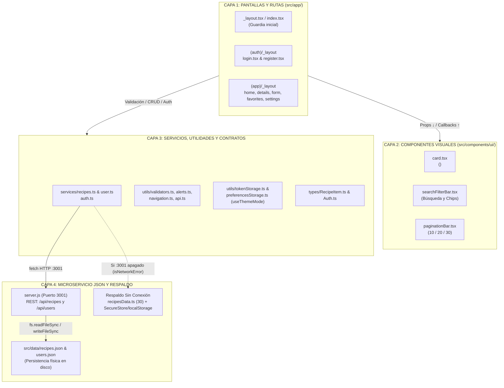
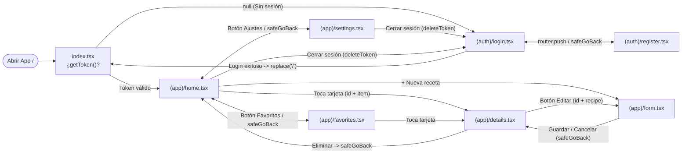
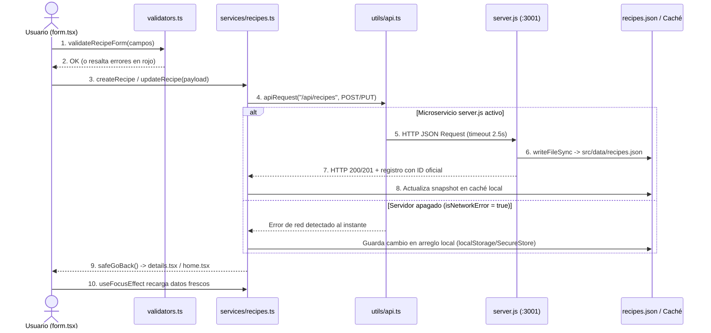

# Guía Modular, Mapa de Relaciones y Experimentos Prácticos — GastroLab

> **Enfoque de este documento:** Análisis **modular archivo por archivo** de los **34 archivos** del proyecto, con analogías sencillas, desglose de componentes/funciones/estados, esquemas visuales de comunicación entre carpetas y ejercicios prácticos para dominar cualquier modificación o pregunta técnica.
> *(Para estudiar el código línea por línea, consulta la rama comentada en Git creada a partir de `main`).*

---

## Parte 1: La Analogía Maestro y Esquemas Visuales de Relaciones

### ¿Cómo funciona todo GastroLab visto como un Restaurante Real?
Imagina que **GastroLab** es un restaurante completo:
* **Las Pantallas (`src/app/`)** son las áreas del local: la puerta con el guardia (`index.tsx`), la recepción (`login.tsx` / `register.tsx`), el salón principal (`home.tsx`), la mesa de detalle (`details.tsx`) y la oficina de ajustes (`settings.tsx`).
* **Los Componentes UI (`src/components/ui/`)** son la vajilla estandarizada (`<Card />`, barra de filtros y paginador): se usan iguales en varias mesas sin reinventar platos.
* **Los Tipos (`src/types/`)** son las fichas oficiales que dicen qué forma exacta debe tener todo platillo.
* **Las Utilidades (`src/utils/`)** son el equipo de apoyo: el guardia que revisa ingredientes (`validators.ts`), el teléfono con el almacén (`api.ts`), el altavoz de avisos (`alerts.ts`) y la libreta de favoritos/luces (`preferencesStorage.ts`).
* **Los Servicios (`src/services/`)** son los chefs ejecutivos que reciben datos crudos y los entregan listos para servir (`adaptRecipeDtoToItem`).
* **El Microservicio (`server.js`) y los JSON (`src/data/*.json`)** son el archivador físico oficial: recibe pedidos por teléfono (HTTP :3001) y escribe/borra con pluma permanente sobre `recipes.json` y `users.json`. Si el archivador está cerrado, el restaurante usa una copia de emergencia en caché local sin detenerse.

### Diagrama 1: Arquitectura Modular por 4 Capas

### Diagrama 2: Mapa de Navegación y Guardias de Sesión (Expo Router)

### Diagrama 3: Secuencia Completa de Comunicación CRUD (Online + Fallback Offline)

### Matriz de Comunicación Entre Módulos
| Origen (Emisor) | Canal / Mecanismo | Qué Viaja | Destino (Receptor) |
| :--- | :--- | :--- | :--- |
| `src/app/index.tsx` | `tokenStorage.getToken()` | Lee token al inicio para decidir ruta pública vs privada. | `-> (auth)/login o (app)/home` |
| `src/app/(app)/_layout.tsx` | `tokenStorage.getToken() + navigation.safeGoBack()` | Bloquea pantallas privadas si no hay sesión y controla "← Volver". | `-> (auth)/login o stack seguro` |
| `src/app/(auth)/login.tsx y register.tsx` | `utils/auth.ts + services/user.ts + utils/validators.ts` | Valida entradas y autentica/registra/recupera usuarios. | `-> server.js (/api/users -> users.json)` |
| `src/app/(app)/home.tsx y favorites.tsx` | `services/recipes.ts + components/ui/* + preferencesStorage.ts` | Carga catálogo en foco, filtra/pagina en memoria y renderiza <Card />. | `-> /details, /form, /favorites, /settings` |
| `src/app/(app)/details.tsx y form.tsx` | `services/recipes.ts + validators.ts + alerts.ts + navigation.ts` | Lee detalle fresco, valida, normaliza imagen y envía POST/PUT/DELETE. | `-> server.js (/api/recipes -> recipes.json)` |
| `src/app/(app)/settings.tsx` | `preferencesStorage.ts (useThemeMode) + services/user.ts` | Emite cambios globales de Modo Oscuro/Claro en vivo y actualiza cuenta. | `-> Todas las pantallas + users.json` |
| `src/services/recipes.ts` | `utils/api.ts (apiRequest) + data/recipesData.ts` | Traduce DTOs con adaptRecipeDtoToItem() y maneja fallback offline. | `-> server.js (:3001) o caché local` |
| `server.js` | `fs.readFileSync / fs.writeFileSync` | Recibe HTTP JSON REST y escribe físicamente en disco. | `-> src/data/recipes.json y users.json` |

---

## Parte 2: Análisis Modular Detallado de Cada Archivo (34 Archivos)

### Módulo 1: Raíz, Configuración y Control de Versiones
*Define la identidad de Expo, librerías instaladas, reglas estrictas de TypeScript y qué carpetas ignora Git.*

#### `package.json`
* **Rol:** Manifiesto de dependencias y scripts ejecutables del proyecto
* **Analogía y descripción simple:** Es la lista de ingredientes y recetas rápidas de la cocina: le dice a npm qué librerías traer (Expo 58, React 19, TypeScript) y qué atajos existen ("npm run server", "npm test", "npm run web"). Configura el punto de entrada ("main": "expo-router/entry"), las versiones exactas de dependencias móviles/web y los comandos de terminal para arrancar el microservicio JSON, la app y las pruebas.
* **Desglose por secciones / módulos internos:**
  * **Identidad y Entrada:** "name": "gastrolab", "main": "expo-router/entry": indica a Expo que las pantallas nacen desde la carpeta src/app/.
  * **dependencies:** Incluye expo ~58.0.25, expo-router, expo-secure-store, expo-image-picker, expo-constants, react 19.3.0 y react-native 0.88.1.
  * **devDependencies:** Incluye @types/react y typescript ~6.0.3 para verificar tipos estáticos sin costo en producción.
  * **scripts:** Define "server" (node server.js), "test" (node --test tests/gastrolab.test.mjs), "start", "android", "ios", "web" y "lint".
* **Comunicación con otros archivos:** Usado por npm/Node al ejecutar comandos; typescript del bloque devDependencies es aprovechado también por tests/gastrolab.test.mjs.
* **Ejercicios y experimentos recomendados (estilo profesor):**
  1. **Cambiar el puerto por defecto desde un script:** Cambia "server": "PORT=3005 node server.js" (en Linux/Mac) o $env:PORT=3005 en PowerShell para ver cómo server.js escucha otro puerto. -> *Resultado esperado:* Útil si el puerto 3001 estuviera ocupado por otro proyecto.
  2. **Ejecutar el nuevo script de pruebas:** Corre "npm test" en terminal. -> *Resultado esperado:* Verás pasar las 9 pruebas automatizadas del CRUD, validadores y modo offline en ~2 segundos.

#### `app.json`
* **Rol:** Configuración nativa de Expo SDK 58 (iOS, Android, Web y Permisos)
* **Analogía y descripción simple:** Es el pasaporte técnico de la aplicación ante las tiendas (Google Play / App Store) y el navegador. Controla el nombre visible ("GastroLab"), la rotación de pantalla ("orientation": "default"), la arquitectura nueva ("newArchEnabled": true), el bundler web de Metro y los permisos de galería.
* **Desglose por secciones / módulos internos:**
  * **Identidad y Rotación:** "name", "slug", "scheme": "gastrolab" y "orientation": "default" (permite girar libremente entre vertical y horizontal).
  * **Plataformas ("ios", "android", "web"):** En web configura "bundler": "metro" y "output": "single" (SPA para navegador). En iOS activa "supportsTablet": true.
  * **plugins:** Registra expo-router, expo-secure-store, expo-splash-screen y expo-image-picker con el mensaje personalizado en español para permisos de fotos.
* **Comunicación con otros archivos:** Leído por Expo CLI al construir/correr la app y por src/utils/api.ts indirectamente a través de Constants.expoConfig.
* **Ejercicios y experimentos recomendados (estilo profesor):**
  1. **Bloquear la rotación en Portrait si lo pide el profesor:** Cambia "orientation": "default" por "orientation": "portrait". -> *Resultado esperado:* Al reiniciar Expo Go en el teléfono, la app dejará de rotar aunque gires el celular. Devuélvelo a "default" al terminar.
  2. **Cambiar el mensaje de permiso de fotos:** Edita "photosPermission" dentro de plugins -> expo-image-picker. -> *Resultado esperado:* Ese texto aparece cuando iOS/Android pregunta si dejas que GastroLab entre a tu galería.

#### `tsconfig.json`
* **Rol:** Reglas del compilador TypeScript y alias @/*
* **Analogía y descripción simple:** Es el diccionario de atajos y el inspector estricto que revisa cada archivo antes de ejecutar la app. Habilita la verificación estricta de tipos ("strict": true) heredando expo/tsconfig.base y mapea "@/*" hacia "./src/*" para importaciones limpias.
* **Desglose por secciones / módulos internos:**
  * **extends y strict:** Extiende la configuración oficial de Expo e impone "strict": true (prohíbe variables implícitas undefined/any sin control).
  * **paths ("@/*"):** Permite escribir import { getRecipes } from "@/services/recipes" en lugar de "../../services/recipes".
  * **include:** Cubre todos los archivos "**/*.ts" y "**/*.tsx" (dejando fuera archivos .mjs de pruebas para no exigir @types/node).
* **Comunicación con otros archivos:** Afecta a todos los archivos .ts y .tsx de src/ al correr "npx tsc --noEmit" o en el editor.
* **Ejercicios y experimentos recomendados (estilo profesor):**
  1. **Comprobar qué protege strict: true:** En cualquier pantalla, borra temporalmente un parámetro obligatorio de una llamada (ej. saveToken() sin argumentos) y corre "npx tsc --noEmit". -> *Resultado esperado:* TypeScript te avisará exactamente en qué archivo y línea falta el dato antes de que truene en el celular.

#### `.gitignore`
* **Rol:** Lista de archivos y carpetas excluidos de Git
* **Analogía y descripción simple:** Es el filtro de la mochila antes de viajar: guarda tu código y documentos, pero deja fuera carpetas pesadas o temporales que se reconstruyen solas. Evita subir node_modules/, cachés de .expo/, builds web, llaves nativas, logs npm y temporales de Word (~$*) al repositorio.
* **Desglose por secciones / módulos internos:**
  * **Dependencias y builds:** Ignora node_modules/, .expo/, dist/, web-build/ y *.tsbuildinfo.
  * **Temporales del sistema y Office:** Ignora .DS_Store, ~$* (archivos candado que crea Word al abrir un .docx) y *.tmp.
* **Comunicación con otros archivos:** Usado automáticamente por Git al ejecutar git status y git add.
* **Ejercicios y experimentos recomendados (estilo profesor):**
  1. **Probar cómo ignora node_modules:** Ejecuta "git status" después de instalar o correr pruebas. -> *Resultado esperado:* Verás que ni node_modules/ ni .expo/ aparecen como archivos pendientes de subir.

---

### Módulo 2: Microservicio JSON Local y Suite de Pruebas
*El puente mínimo en Node.js que guarda físicamente los cambios en JSON y las pruebas automatizadas que validan todo el flujo.*

#### `server.js`
* **Rol:** Microservicio HTTP REST mínimo sobre recipes.json y users.json (Puerto 3001)
* **Analogía y descripción simple:** Es el bibliotecario en la ventanilla del archivo: como el navegador web no tiene permiso de escribir carpetas en tu computadora por seguridad, le pide al bibliotecario (server.js) que anote, edite o borre renglones dentro de recipes.json y users.json. Servidor Node.js puro (cero librerías externas) que expone endpoints CRUD en http://localhost:3001 para leer y escribir físicamente src/data/recipes.json y src/data/users.json.
* **Desglose por secciones / módulos internos:**
  * **Helpers HTTP y JSON (sendJson, setCorsHeaders, readJsonFile, writeJsonFile, parseBody, toSafeLikeRate):** Configura CORS abierto (*) para Expo Web, lee JSON seguro de disco (creando carpetas si faltan), parsea cuerpos JSON y acota likerate entre 0 y 100.
  * **Salud (GET / y GET /health):** Responde status: "ok" con recipesCount y usersCount actuales en disco.
  * **Rutas de Recetas (/api/recipes y /api/recipes/:id):** GET lista todas (o filtra con ?search=); GET /:id devuelve una o 404; POST crea con id = maxId + 1 al inicio (unshift); PUT actualiza campos y devuelve 200 (o 404); DELETE elimina del arreglo.
  * **Rutas de Usuarios (/api/users y /api/users/:id):** GET lista usuarios o detalle por ID; POST valida email/password, rechaza correos repetidos con 409 Conflict y guarda en users.json; PUT actualiza correo/contraseña validando que el correo no pertenezca a otro ID.
  * **Exportación y Arranque (createAppServer):** Exporta createAppServer({ recipesFile, usersFile }) para pruebas aisladas y solo abre el puerto 3001 cuando se ejecuta directo con "node server.js".
* **Comunicación con otros archivos:** Recibe peticiones fetch desde src/utils/api.ts; lee/escribe físicamente src/data/recipes.json y src/data/users.json; es probado directamente por tests/gastrolab.test.mjs.
* **Ejercicios y experimentos recomendados (estilo profesor):**
  1. **Hacer que nuevas recetas se agreguen al final del JSON:** En POST /api/recipes cambia "recipes.unshift(newRecipe)" por "recipes.push(newRecipe)". -> *Resultado esperado:* Reinicia server.js, crea una receta y abre recipes.json: verás el registro nuevo al final del arreglo en vez del principio.
  2. **Probar el servidor directo desde terminal:** Con server.js activo, ejecuta: node -e "fetch('http://localhost:3001/health').then(r=>r.json()).then(console.log)". -> *Resultado esperado:* Imprime el conteo real de recetas y usuarios en JSON.

#### `tests/gastrolab.test.mjs`
* **Rol:** Suite automatizada end-to-end (node:test) sin dependencias externas
* **Analogía y descripción simple:** Es el inspector de calidad nocturno: crea una cocina de juguete temporal en el directorio temp del sistema, cocina un menú completo (crear, leer, editar, borrar, fallo de red) y verifica que no quede ningún plato roto antes de entregar. Contiene 9 pruebas automáticas en 3 suites usando node:test y el compilador TypeScript instalado para cargar y verificar módulos reales.
* **Desglose por secciones / módulos internos:**
  * **Cargador TypeScript en memoria (loadTsModule):** Transpila en vivo archivos .ts usando typescript.transpileModule sustituyendo módulos nativos (react-native, expo-secure-store) por mocks ligeros.
  * **Suite 1 — Microservicio JSON (5 tests):** Prueba /health, búsqueda ?search=, ciclo CRUD completo verificando disco físico, rechazo 400/404 y registro/duplicados 409/actualización en users.json.
  * **Suite 2 — Validadores y Adaptador (2 tests):** Verifica validateRecipeForm (rangos, formatos HH:MM:SS) y adaptRecipeDtoToItem (normalización string -> number e imagen fallback).
  * **Suite 3 — Integración Cliente -> Server y Offline (2 tests):** Ejecuta el flujo auth -> create -> update -> get -> delete con los servicios TypeScript reales, verifica que un 404 no se silencie y valida el respaldo offline cuando server.js está apagado.
* **Comunicación con otros archivos:** Importa server.js (createAppServer), transpila src/utils/validators.ts, src/utils/auth.ts, src/services/user.ts, src/services/recipes.ts y src/utils/api.ts usando copias temporales de recipes.json y users.json.
* **Ejercicios y experimentos recomendados (estilo profesor):**
  1. **Comprobar que una prueba detecta un fallo real:** Cambia temporalmente una regla en validators.ts (ej. permite likerate > 100) y corre "npm test". -> *Resultado esperado:* La prueba de validadores fallará inmediatamente avisando exactamente qué validación se rompió.

---

### Módulo 3: Capa de Datos JSON y Respaldo Offline (src/data/)
*Contiene las bases de datos JSON físicas en disco y el catálogo semilla de respaldo para modo sin conexión.*

#### `src/data/recipes.json`
* **Rol:** Base de datos física en JSON con las recetas del catálogo
* **Analogía y descripción simple:** Es el recetario maestro impreso en una carpeta de argollas donde puedes ver, agregar, tachar o corregir recetas y quedan guardadas en papel real. Arreglo JSON estándar de objetos receta (id, title, description, imageURL, preparetime, likerate, category, difficulty) administrado en vivo por server.js.
* **Desglose por secciones / módulos internos:**
  * **Estructura de cada registro:** Cada objeto guarda nombres tipo DTO: preparetime ("HH:MM:SS"), likerate (entero 0..100), imageURL (URL o Data URI Base64) y textos descriptivos.
  * **Regla de oro de sintaxis JSON:** No admite comentarios // ni /* */ ni comas finales después del último campo, o JSON.parse() fallaría.
* **Comunicación con otros archivos:** Leído y escrito en disco exclusivamente por server.js (GET/POST/PUT/DELETE /api/recipes). No se importa directo en React Native para evitar recargas de Metro.
* **Ejercicios y experimentos recomendados (estilo profesor):**
  1. **Editar una receta directo en disco:** Con server.js activo, cambia el campo "title" del id 1 en recipes.json, guarda y desliza para refrescar en Home. -> *Resultado esperado:* La tarjeta en la pantalla actualizará su título automáticamente leyendo el disco.

#### `src/data/users.json`
* **Rol:** Base de datos física en JSON con las cuentas de usuario
* **Analogía y descripción simple:** Es el cuaderno de llaves del restaurante donde está anotado quién tiene acceso y con qué contraseña. Arreglo JSON de usuarios ({ id, email, password }) inicializado con la cuenta administradora admin@gastrolab.com / 1234 y actualizado por server.js al registrar o cambiar credenciales.
* **Desglose por secciones / módulos internos:**
  * **Registro inicial:** Contiene al usuario id: 1 ("admin@gastrolab.com", contraseña "1234").
  * **Actualizaciones vivas:** Crece con cada registro en register.tsx (POST /api/users) y cambia al editar correo/clave en settings.tsx o recuperar clave en login.tsx (PUT /api/users/:id).
* **Comunicación con otros archivos:** Leído y escrito por server.js bajo las rutas /api/users y /api/users/:id; consultado por auth.ts y user.ts.
* **Ejercicios y experimentos recomendados (estilo profesor):**
  1. **Agregar un segundo usuario a mano en JSON:** Añade { "id": 2, "email": "chef@gastrolab.com", "password": "abcd" } al arreglo y guarda. -> *Resultado esperado:* Ve directo a Login e inicia sesión con chef@gastrolab.com / abcd sin pasar por Registro.

#### `src/data/recipesData.ts`
* **Rol:** Catálogo estático de respaldo para modo sin conexión (sin server.js)
* **Analogía y descripción simple:** Es la copia de emergencia plastificada en la cocina: si se va la luz en la oficina del archivo (server.js apagado), igual tienes las 30 recetas base para seguir cocinando. Exporta la constante INITIAL_RECIPES_DATA con las 30 recetas originales tipadas como RawRecipeDto[] exclusivamente como semilla inicial cuando el microservicio no responde.
* **Desglose por secciones / módulos internos:**
  * **INITIAL_RECIPES_DATA:** Arreglo de 30 RawRecipeDto idénticos al set inicial de recipes.json.
  * **Aislamiento de HMR:** Al ser código TypeScript estático y nunca reescribirse en disco durante ejecución, Metro no recarga la app accidentalmente al usar el CRUD.
* **Comunicación con otros archivos:** Importado únicamente por src/services/recipes.ts dentro de getOfflineSeededRecipes().
* **Ejercicios y experimentos recomendados (estilo profesor):**
  1. **Probar el modo sin conexión:** Apaga server.js (Ctrl+C), borra el almacenamiento del navegador e inicia la app. -> *Resultado esperado:* Verás las 30 recetas intactas gracias a INITIAL_RECIPES_DATA.

---

### Módulo 4: Contratos e Interfaces TypeScript (src/types/)
*El lenguaje común de todo el proyecto: garantiza que pantallas, componentes y servicios hablen el mismo idioma.*

#### `src/types/RecipeItem.ts`
* **Rol:** Modelos de receta, categorías válidas, dificultades y filtros
* **Analogía y descripción simple:** Es el molde oficial de los platillos y el menú de categorías del restaurante: define qué campos lleva obligatoriamente cada receta y qué categorías acepta el sistema. Centraliza los tipos Unión de Categoría/Dificultad, sus arreglos para renderizar chips de UI y validación, el DTO crudo, el modelo limpio de UI y el estado de filtros.
* **Desglose por secciones / módulos internos:**
  * **Tipos y Listas de Dominio:** RecipeCategory, RecipeDifficulty, RECIPE_CATEGORIES (con "Todas" para filtrar), VALID_RECIPE_CATEGORIES (sin "Todas" para formularios), RECIPE_DIFFICULTIES y VALID_RECIPE_DIFFICULTIES.
  * **RawRecipeDto vs RecipeItem:** RawRecipeDto acepta tipos crudos (id/likerate pueden venir como string, preparetime en minúsculas); RecipeItem garantiza tipos limpios y camelCase (id: number, likeRate: number, prepareTime: string, image).
  * **RecipeFormPayload, SortOption y RecipeFilterState:** Define el objeto exacto que envía el formulario al guardar y la estructura de los 5 filtros combinados de HomeScreen.
* **Comunicación con otros archivos:** Importado por recipesData.ts, recipes.ts, validators.ts, searchFilterBar.tsx, home.tsx, details.tsx, form.tsx, favorites.tsx y settings.tsx.
* **Ejercicios y experimentos recomendados (estilo profesor):**
  1. **Agregar una categoría nueva a toda la app en 1 archivo:** Añade "Veganas" en RecipeCategory, RECIPE_CATEGORIES y VALID_RECIPE_CATEGORIES. -> *Resultado esperado:* Al guardar, aparecerá automáticamente el chip "Veganas" tanto en los filtros de Home, en Ajustes y en el selector del Formulario.

#### `src/types/Auth.ts`
* **Rol:** Contratos de autenticación, sesión activa y preferencias de usuario
* **Analogía y descripción simple:** Es el formato de la credencial del empleado y su hoja de preferencias personales. Define las respuestas esperadas de verificación/perfil, el objeto UserSession guardado tras login, las opciones válidas de paginación y UserSettings.
* **Desglose por secciones / módulos internos:**
  * **Respuestas de Cuenta:** LoginSuccessResponse, RegisterResponse, UpdateCredentialsResponse (exists, valid, id, affected_rows) y UserProfileResponse.
  * **UserSession:** Agrupa { id: number, email: string, token: string } de quien inició sesión.
  * **PageSizeOption y UserSettings:** Limita paginación a 10 | 20 | 30 y define itemsPerPage, themeMode ("light" | "dark"), defaultCategory y compactCards.
* **Comunicación con otros archivos:** Importado por tokenStorage.ts, preferencesStorage.ts, user.ts, paginationBar.tsx, home.tsx, favorites.tsx y settings.tsx.
* **Ejercicios y experimentos recomendados (estilo profesor):**
  1. **Habilitar paginación de 5 en 5:** Cambia PageSizeOption = 10 | 20 | 30 por PageSizeOption = 5 | 10 | 20 | 30 (y agrega 5 en paginationBar.tsx, settings.tsx y preferencias). -> *Resultado esperado:* TypeScript te guiará exactamente en los lugares donde haga falta aceptar el número 5.

---

### Módulo 5: Utilidades e Infraestructura (src/utils/)
*La caja de herramientas del proyecto: red HTTP, alertas multiplataforma, navegación segura, almacenamiento, validaciones y autenticación.*

#### `src/utils/api.ts`
* **Rol:** Cliente HTTP central con detección automática de host y timeout
* **Analogía y descripción simple:** Es el mensajero inteligente: sabe a qué dirección física llamar según estés en la compu o en tu celular por Wi-Fi, y si la ventanilla tarda más de 2.5 segundos en abrir, avisa "servidor apagado" sin congelar la app. Resuelve dinámicamente la URL base hacia server.js (puerto 3001), lanza peticiones JSON con AbortController y distingue errores reales del servidor (ApiError isNetworkError=false) de fallos de red (isNetworkError=true).
* **Desglose por secciones / módulos internos:**
  * **getApiBaseUrl() y API_BASE_URL:** En Web usa window.location.hostname:3001; en teléfono físico con Expo Go extrae la IP de tu PC desde Constants.expoConfig.hostUri; en emulador Android usa 10.0.2.2:3001.
  * **Clase ApiError:** Extiende Error guardando status HTTP y el booleano isNetworkError para decidir cuándo activar respaldo offline y cuándo mostrar un error real (ej. 404 o 409).
  * **apiRequest<T>() y fetchWithAuth<T>():** Ejecuta fetch con timeout de 2.5s, parsea JSON del error devuelto por server.js y provee guardia opcional con token.
* **Comunicación con otros archivos:** Usado por src/services/recipes.ts, src/services/user.ts y src/utils/auth.ts para hablar con server.js; consulta tokenStorage.ts.
* **Ejercicios y experimentos recomendados (estilo profesor):**
  1. **Cambiar el tiempo de espera cuando el server está apagado:** Cambia REQUEST_TIMEOUT_MS = 2500 por 5000 o 500. -> *Resultado esperado:* Verás qué tan rápido cambia al respaldo offline en caso de que olvides encender el servidor.

#### `src/utils/alerts.ts`
* **Rol:** Puente de alertas y confirmaciones compatible con Web, iOS y Android
* **Analogía y descripción simple:** Es un altavoz bilingüe: en iPhone/Android habla con cuadros nativos Alert.alert, pero en Web donde Alert.alert de react-native-web es mudo (no hace nada), traduce a window.alert y window.confirm. Resuelve el problema de que Alert.alert en react-native-web es una función vacía, unificando avisos informativos y diálogos destructivos de confirmación en 30 líneas.
* **Desglose por secciones / módulos internos:**
  * **showAlert(title, message):** En Platform.OS === "web" llama a window.alert; en móvil llama a Alert.alert.
  * **confirmAction(title, message, onConfirm):** En Web abre window.confirm(message) y ejecuta onConfirm() si acepta; en móvil muestra Alert.alert con botones "Cancelar" y "Eliminar" (estilo destructive).
* **Comunicación con otros archivos:** Usado por login.tsx, register.tsx, details.tsx, form.tsx y settings.tsx.
* **Ejercicios y experimentos recomendados (estilo profesor):**
  1. **Verificar la diferencia en Web:** En Chrome/Edge intenta guardar una receta en form.tsx con el título de 1 letra. -> *Resultado esperado:* Aparecerá tanto la alerta emergente de navegador como el banner rojo dentro de la tarjeta.

#### `src/utils/navigation.ts`
* **Rol:** Retroceso seguro sin errores de historial vacío (GO_BACK)
* **Analogía y descripción simple:** Es el copiloto antes de dar reversa: primero mira por el espejo si hay camino atrás (canGoBack); si la pantalla se abrió directo por enlace/recarga y no hay adónde regresar, conduce directo a /home. Previene la advertencia/error de desarrollo "The action GO_BACK was not handled by any navigator" en Expo Router Web y móvil.
* **Desglose por secciones / módulos internos:**
  * **NavigationCapableRouter y safeGoBack(router, fallbackRoute):** Verifica router.canGoBack(): si es true llama router.back(); en caso contrario o error usa router.replace(fallbackRoute) (por defecto "/home").
* **Comunicación con otros archivos:** Usado por el botón "← Volver" de (auth)/_layout.tsx y (app)/_layout.tsx, y al volver/cancelar/guardar en details.tsx y form.tsx.
* **Ejercicios y experimentos recomendados (estilo profesor):**
  1. **Probar recarga directa de ruta en Web:** Entra en Web a http://localhost:8081/details?id=1, recarga el navegador (F5) y presiona "← Volver". -> *Resultado esperado:* En lugar de arrojar error GO_BACK en consola, te llevará limpiamente a /home.

#### `src/utils/tokenStorage.ts`
* **Rol:** Almacenamiento seguro del token y datos de sesión
* **Analogía y descripción simple:** Es la cartera personal del usuario: guarda el gafete de acceso (auth_token) y los datos de identificación (UserSession) adaptándose si estás en bolsillo Web (localStorage) o móvil (SecureStore). Gestiona lectura, escritura y borrado de sesión usando la función guardiana isWebStorageAvailable() para soportar SSR/Node, navegadores Web y Expo SecureStore con respaldo en memoria RAM.
* **Desglose por secciones / módulos internos:**
  * **isWebStorageAvailable():** Valida Platform.OS === "web" && typeof localStorage !== "undefined" para no tronar en pre-renderizados SSR.
  * **saveToken, getToken y deleteToken / removeToken:** Guarda y recupera "auth_token" sincronizando tokenInMemory.
  * **saveUserSession y getUserSession:** Guarda el objeto JSON completo { id, email, token }; si falta el JSON de sesión pero existe el token "gastrolab-token-{id}-...", reconstruye automáticamente el id con expresión regular.
* **Comunicación con otros archivos:** Consultado por index.tsx, (app)/_layout.tsx, login.tsx, home.tsx, settings.tsx, auth.ts, recipes.ts, user.ts, api.ts y preferencesStorage.ts.
* **Ejercicios y experimentos recomendados (estilo profesor):**
  1. **Simular expiración o cierre de sesión desde consola Web:** En DevTools de Chrome (Application -> Local Storage) borra "auth_token" y recarga la página. -> *Resultado esperado:* Index y AppLayout detectarán !token y te expulsarán de inmediato a /(auth)/login.

#### `src/utils/preferencesStorage.ts`
* **Rol:** Motor de preferencias, tema reactivo global, favoritos y caché offline simple
* **Analogía y descripción simple:** Es el tablero de memoria personal del usuario + el interruptor maestro de luz del edificio: guarda qué recetas amas (favoritos), tu tamaño de página favorito y avisa a todas las pantallas al instante si encendiste el Modo Oscuro. Centraliza persistencia multiplataforma (chunking de 1800 caracteres para superar el límite de 2 KB de SecureStore en móvil), el sistema reactivo useThemeMode() y los arreglos de caché local.
* **Desglose por secciones / módulos internos:**
  * **Helpers privados de almacenamiento (readStorageItem, writeStorageItem, removeStorageItem):** Divide cadenas largas en pedazos __chunk_0, __chunk_1... dentro de SecureStore o usa localStorage en Web.
  * **Favoritos por usuario (getFavorites, toggleFavorite, removeFavorite):** Guarda IDs de recetas bajo clave única gastrolab_favorites_{userId}; removeFavorite limpia IDs cuando se elimina una receta.
  * **Tema Reactivo y Ajustes (getUserSettings, saveUserSettings, useThemeMode):** Usa un Set themeListeners y gastrolab_global_theme para que al cambiar tema en Ajustes se repinten en vivo las 8 pantallas y los encabezados Stack.
  * **Caché local simple (getLocalRecipes, saveLocalRecipes, resetLocalRecipeChanges, getLocalUsers, saveLocalUsers):** Un solo arreglo limpio de recetas y usuarios para operar si server.js está apagado.
* **Comunicación con otros archivos:** Usado por TODAS las pantallas (vía useThemeMode), home.tsx, details.tsx, favorites.tsx, settings.tsx, recipes.ts, user.ts y auth.ts.
* **Ejercicios y experimentos recomendados (estilo profesor):**
  1. **Cambiar preferencias iniciales por defecto:** Edita DEFAULT_USER_SETTINGS (ej. themeMode: "dark" o itemsPerPage: 20) y borra preferencias previas en el dispositivo. -> *Resultado esperado:* La app iniciará por defecto en modo oscuro o mostrando 20 recetas por página.

#### `src/utils/validators.ts`
* **Rol:** Motor de reglas de validación de formularios y verificación de tipos
* **Analogía y descripción simple:** Es el guardia en la entrada de la cocina que revisa ingredientes y cantidades antes de prender la estufa: no deja pasar correos falsos, tiempos inventados ("abc") ni calificaciones fuera de 0 a 100. Contiene validadores puros (sin efectos secundarios) que retornan { isValid, errorMessage, fieldErrors } para mostrar mensajes exactos en rojo debajo de cada campo.
* **Desglose por secciones / módulos internos:**
  * **Expresiones regulares y email (EMAIL_REGEX, TIME_REGEX, isValidEmail):** Exige formato correo@dominio.ext y tiempo estricto HH:MM:SS con minutos y segundos válidos [00-59].
  * **validateAuthForm(email, password, options):** Valida login y registro (exige 4+ caracteres y confirmación coincidente en registro).
  * **validateRecipeForm(input):** Exige título 3..80 chars, descripción 10+ chars, imagen obligatoria, prepareTime HH:MM:SS, likeRate entero 0..100, categoría y dificultad del catálogo.
  * **validateCredentialsForm(currentPassword, newEmail, newPassword):** Verifica contraseña actual ingresada, email válido y nueva contraseña mínima de 4 caracteres.
* **Comunicación con otros archivos:** Llamado por login.tsx, register.tsx, form.tsx y settings.tsx; importado por tests/gastrolab.test.mjs; usa listas válidas de RecipeItem.ts.
* **Ejercicios y experimentos recomendados (estilo profesor):**
  1. **Hacer la validación más estricta o relajada:** En validateRecipeForm cambia cleanTitle.length < 3 por < 5 o permite likerate desde 10. -> *Resultado esperado:* Al probar en form.tsx (y corriendo npm test), verás los nuevos mensajes de validación al instante.

#### `src/utils/auth.ts`
* **Rol:** Operaciones de inicio de sesión y registro de nuevas cuentas
* **Analogía y descripción simple:** Es el recepcionista que verifica tu credencial en la lista oficial (users.json) y te entrega tu gafete (token) para pasar, o da de alta a nuevos miembros. Ejecuta login() y registerUser() comunicándose primero con server.js (/api/users) para persistir usuarios en src/data/users.json y usando caché local solo ante fallo de red.
* **Desglose por secciones / módulos internos:**
  * **fetchUsersWithFallback():** Pide GET /api/users a server.js, sincroniza el caché local saveLocalUsers() y solo ante ApiError con isNetworkError usa getLocalUsers().
  * **login(email, password):** Compara correo (ignorando mayúsculas) y contraseña; genera token "gastrolab-token-{id}-{timestamp}" y guarda sesión completa con saveUserSession().
  * **registerUser(email, password):** Envía POST /api/users (propaga error HTTP 409 si el correo ya existe); en modo sin conexión guarda localmente verificando duplicados.
* **Comunicación con otros archivos:** Usa apiRequest (api.ts), preferencesStorage.ts y tokenStorage.ts; consumido por login.tsx y register.tsx.
* **Ejercicios y experimentos recomendados (estilo profesor):**
  1. **Ver qué contiene el token generado:** Abre tokenStorage/localStorage después de iniciar sesión y observa el valor de "auth_token". -> *Resultado esperado:* Verás el formato gastrolab-token-1-..., de donde también se extrae el ID de usuario.

---

### Módulo 6: Servicios del Dominio (src/services/)
*La capa intermedia que traduce formatos, protege rutas con autenticación y orquesta llamadas al microservicio JSON o caché local.*

#### `src/services/recipes.ts`
* **Rol:** Motor completo CRUD de recetas y adaptador DTO -> UI
* **Analogía y descripción simple:** Es el chef ejecutivo: recibe ingredientes crudos de la bodega (RawRecipeDto del JSON), los limpia y emplata idénticos para el comedor (adaptRecipeDtoToItem -> RecipeItem), y gestiona crear, editar o tirar platillos sincronizando disco y caché. Expone las 5 funciones CRUD (getRecipes, getRecipe, createRecipe, updateRecipe, deleteRecipe) más adaptRecipeDtoToItem y la imagen fallback DEFAULT_RECIPE_IMAGE.
* **Desglose por secciones / módulos internos:**
  * **Seguridad y Constantes (DEFAULT_RECIPE_IMAGE, ensureAuthenticated):** Garantiza imagen culinaria de respaldo y exige un token activo antes de cualquier operación.
  * **Patrón Adaptador (adaptRecipeDtoToItem):** Convierte IDs y likerate en number seguro, limpia cadenas, asegura formato HH:MM:SS y sustituye URLs vacías por DEFAULT_RECIPE_IMAGE.
  * **Helpers de Sincronización (toServerRecipeBody, filterBySearch, getOfflineSeededRecipes):** Formatea el JSON esperado por server.js, aplica búsqueda por título/descripción/categoría e inicializa el respaldo con INITIAL_RECIPES_DATA.
  * **CRUD Completo (getRecipes, getRecipe, createRecipe, updateRecipe, deleteRecipe):** Ejecuta GET/POST/PUT/DELETE vía apiRequest; usa el ID devuelto por server.js al crear; propaga errores reales HTTP (404/400) y limpia favoritos al eliminar.
* **Comunicación con otros archivos:** Consumido por home.tsx, details.tsx, form.tsx, favorites.tsx y card.tsx; depende de api.ts, preferencesStorage.ts, tokenStorage.ts y recipesData.ts.
* **Ejercicios y experimentos recomendados (estilo profesor):**
  1. **Cambiar la foto de respaldo por defecto:** Reemplaza DEFAULT_RECIPE_IMAGE por otra URL válida y crea o abre una receta con URL de imagen rota. -> *Resultado esperado:* Al fallar la carga en <Image onError />, aparecerá automáticamente tu nueva imagen de respaldo.
  2. **Hacer que getRecipes devuelva las más populares primero:** Ordena "adapted" antes de retornarlo o cambia el orden en searchFilterBar. -> *Resultado esperado:* Verás cambiar el orden inicial del catálogo.

#### `src/services/user.ts`
* **Rol:** Gestión de perfil, recuperación de clave y actualización de credenciales
* **Analogía y descripción simple:** Es la oficina de Recursos Humanos: revisa si tu correo existe cuando olvidas tu clave, verifica tu clave actual antes de permitir cambios y actualiza tu ficha oficial en users.json. Provee getUserProfile, verifyEmail, verifyPassword y updateCredentials (con alias compatibilidad) conectados a GET/PUT /api/users en server.js y respaldo local.
* **Desglose por secciones / módulos internos:**
  * **loadUsersList() y getUserProfile(userId):** Obtiene perfil { id, email } verificando sesión activa.
  * **verifyEmail(currentEmail) y verifyPassword(userId, currentPassword):** Valida existencia de cuenta para recuperación en login.tsx y verifica contraseña actual en settings.tsx.
  * **updateCredentials(userId, newEmail, newPassword):** Envía PUT /api/users/:id actualizando src/data/users.json y sincronizando caché local; propaga error 409 si otro usuario ya usa el correo.
* **Comunicación con otros archivos:** Llamado por login.tsx (recuperación) y settings.tsx (perfil y cambio de correo/clave); usa api.ts, preferencesStorage.ts y tokenStorage.ts.
* **Ejercicios y experimentos recomendados (estilo profesor):**
  1. **Cambiar correo de cuenta y verificar en users.json:** En la app ve a Ajustes, actualiza tu correo usando la clave actual y abre src/data/users.json. -> *Resultado esperado:* Verás actualizado el correo en el archivo físico al instante y reflejado al recargar.

---

### Módulo 7: Componentes Reutilizables de UI (src/components/ui/)
*Piezas visuales modulares tipo "Lego" controladas 100% por Props y Callbacks, con soporte completo de Modo Claro y Oscuro.*

#### `src/components/ui/card.tsx`
* **Rol:** Tarjeta visual de una receta con foto, insignias y botón de favorito
* **Analogía y descripción simple:** Es el platillo ya servido en la carta: no sabe de dónde vino la receta ni cómo se guarda un favorito; solo muestra los datos que le pasa su padre (Props) y avisa cuando alguien lo toca. Componente funcional <Card /> basado en <Pressable> con efecto visual pressed, imagen con fallback onError, badge de categoría, corazón ♥ independiente y píldoras de color semántico.
* **Desglose por secciones / módulos internos:**
  * **CardProps y getDifficultyColors():** Define todas las props requeridas (title, image, description, category, difficulty, prepareTime, likeRate, compact, darkMode, onToggleFavorite, onPress) y asigna verde/ámbar/rojo según dificultad y tema.
  * **Estado interno imageSourceUri + useEffect:** Mantiene la URI mostrada y resetea al cambiar prop image; si onError se dispara en <Image />, cambia automáticamente a DEFAULT_RECIPE_IMAGE.
  * **Botón ♥ aislado con e.stopPropagation():** Evita el "bubbling" del evento táctil: tocar el corazón marca favorito sin abrir por accidente la pantalla de Detalle.
  * **Modo compacto y sombras multiplataforma:** Reduce altura de foto (130px vs 200px) y líneas de texto si compact=true, usando Platform.select para boxShadow en Web sin warnings.
* **Comunicación con otros archivos:** Renderizado dentro del FlatList de home.tsx y favorites.tsx; importa DEFAULT_RECIPE_IMAGE de services/recipes.ts.
* **Ejercicios y experimentos recomendados (estilo profesor):**
  1. **Cambiar la altura de las imágenes en tarjetas:** En styles.image modifica height: 200 por 250 (o 160). -> *Resultado esperado:* Todas las tarjetas del catálogo y favoritos cambiarán su proporción al instante.
  2. **Quitar e.stopPropagation() temporalmente para entender bubbling:** Comenta e.stopPropagation() en line 84 y toca el corazón ♥ en Home. -> *Resultado esperado:* Notarás que al tocar el corazón también se abre Detalle; vuelve a descomentarlo para ver la solución.

#### `src/components/ui/searchFilterBar.tsx`
* **Rol:** Barra de búsqueda y chips horizontales de filtros y ordenamiento
* **Analogía y descripción simple:** Es el panel de control y filtros del menú: permite buscar por nombre, filtrar por cocina/dificultad, ver solo favoritos y reordenar la carta. Componente controlado sin estado interno propio: recibe filters, totalResults, favoritesCount y darkMode, y emite callbacks al padre (home.tsx) en cada toque.
* **Desglose por secciones / módulos internos:**
  * **SearchFilterBarProps y SORT_OPTIONS:** Mapea las 4 opciones de ordenamiento (default, likes_desc, time_asc, title_asc) y recibe todos los handlers del filtro.
  * **hasActiveFilters:** Calcula si algún filtro distinto al estado inicial está activo para mostrar u ocultar el botón "Limpiar filtros".
  * **Renderizado de Filtros (TextInput + 3 ScrollView horizontales):** Barra de búsqueda con botón "Buscar" + chips de RECIPE_CATEGORIES, RECIPE_DIFFICULTIES, SORT_OPTIONS y el chip "♥ Solo favoritos (N)".
  * **Resumen de resultados:** Muestra conteo en singular/plural ("1 receta encontrada" / "N recetas encontradas") + botón Limpiar.
* **Comunicación con otros archivos:** Usado exclusivamente en ListHeaderComponent de home.tsx; lee listas constantes de src/types/RecipeItem.ts.
* **Ejercicios y experimentos recomendados (estilo profesor):**
  1. **Cambiar la etiqueta de un botón de ordenamiento:** En SORT_OPTIONS cambia "Mayor aprobación (%)" por "Mejor calificadas". -> *Resultado esperado:* El chip se actualiza en vivo sin cambiar la lógica de ordenamiento.

#### `src/components/ui/paginationBar.tsx`
* **Rol:** Selector de elementos por página (10/20/30) y navegación entre páginas
* **Analogía y descripción simple:** Es el índice al pie de un libro que te dice en qué página vas y te deja pasar de hoja o elegir letras más pequeñas para ver más recetas por hoja. Barra inferior de paginación que calcula el rango visible ("Mostrando A-B de Total") y deshabilita Anterior/Siguiente en los extremos.
* **Desglose por secciones / módulos internos:**
  * **PaginationBarProps y PAGE_SIZE_OPTIONS:** Recibe currentPage, totalPages, totalItems, itemsPerPage, darkMode, onPageChange y onItemsPerPageChange.
  * **Cálculo de rango (startItem, endItem, canGoPrev, canGoNext):** Evita mostrar "1-0 de 0" cuando no hay resultados y desactiva botones cuando no hay página previa o siguiente.
  * **Botones de tamaño [10, 20, 30] y navegación:** Resalta el tamaño activo en rojo terracota (#C0392B) y respeta estilos darkMode.
* **Comunicación con otros archivos:** Usado en ListFooterComponent de home.tsx; recibe PageSizeOption de src/types/Auth.ts.
* **Ejercicios y experimentos recomendados (estilo profesor):**
  1. **Agregar opción para ver 5 recetas por página:** Añade 5 a PageSizeOption (Auth.ts), PAGE_SIZE_OPTIONS (aquí), settings.tsx y validación en preferencesStorage.ts. -> *Resultado esperado:* Permite paginar las 30 recetas en 6 páginas cortas de 5 tarjetas.

---

### Módulo 8: Enrutamiento Raíz y Grupo Público (src/app/ y src/app/(auth)/)
*El vestíbulo y control de acceso de Expo Router: maneja la pantalla de bienvenida (Splash), la redirección según sesión, Login y Registro.*

#### `src/app/_layout.tsx`
* **Rol:** Layout raíz global de Expo Router
* **Analogía y descripción simple:** Es el marco estructural y techo del edificio: envuelve toda la aplicación con área segura (notch del celular), StatusBar, fondo adaptable al tema oscuro y los 3 bloques de navegación. Configura SplashScreen.preventAutoHideAsync() / hideAsync(), SafeAreaProvider, el color de fondo sincronizado con useThemeMode() y registra index, (auth) y (app).
* **Desglose por secciones / módulos internos:**
  * **Control de Splash Screen:** Retiene la pantalla de inicio al montar y la oculta en useEffect cuando React está listo.
  * **SafeAreaProvider, StatusBar y Stack:** Aplica orientation: "default", headerShown: false (los grupos internos ponen su propia barra) y contentStyle dinámico según isDark.
* **Comunicación con otros archivos:** Envuelve toda la app; se suscribe a useThemeMode() en preferencesStorage.ts.
* **Ejercicios y experimentos recomendados (estilo profesor):**
  1. **Probar el fondo global en transición:** Cambia entre Claro y Oscuro en Ajustes y navega rápidamente entre pantallas. -> *Resultado esperado:* Gracias al contentStyle de RootLayout conectado a useThemeMode(), ya no aparece ningún destello blanco.

#### `src/app/index.tsx`
* **Rol:** Guardia inicial de entrada (Gatekeeper "/")
* **Analogía y descripción simple:** Es el guardia en la puerta principal: revisa tu bolsillo al instante de abrir la app; si ya traes pase (auth_token) te deja pasar directo a Home, si no te manda a Login. No renderiza interfaz de negocio: lee getToken() al montar con dos estados (checking, isLoggedIn) y redirige declarativamente con <Redirect />.
* **Desglose por secciones / módulos internos:**
  * **Estados checking / isLoggedIn y IIFE en useEffect:** Lee await getToken(), actualiza setIsLoggedIn(!!token) y apaga setChecking(false).
  * **Spinner y <Redirect />:** Muestra ActivityIndicator centrado mientras checking es true; luego redirige a "/(app)/home" o "/(auth)/login".
* **Comunicación con otros archivos:** Usa getToken() (tokenStorage.ts) y useThemeMode() (preferencesStorage.ts); redirige hacia (app)/home o (auth)/login.
* **Ejercicios y experimentos recomendados (estilo profesor):**
  1. **Observar la diferencia de auto-login:** Inicia sesión, recarga la página (F5) y observa cómo entras directo al catálogo sin volver a escribir contraseña. -> *Resultado esperado:* Luego presiona Cerrar sesión y recarga para ver cómo ahora caes en Login.

#### `src/app/(auth)/_layout.tsx`
* **Rol:** Layout y encabezado del grupo público (Login y Registro)
* **Analogía y descripción simple:** Es el letrero superior de la recepción pública del restaurante. Define la barra de navegación vino/oscuro compartida por login.tsx y register.tsx, ocultando el volver en Login y usando safeGoBack en Registro.
* **Desglose por secciones / módulos internos:**
  * **AuthLayout y headerStyle reactivo:** Cambia fondo del header entre #753333 (claro) y #1F1615 (oscuro) en tiempo real con useThemeMode().
  * **Screen options y headerLeft seguro:** En "login" oculta volver; en "register" renderiza botón "← Volver" llamando safeGoBack(router, "/(auth)/login").
* **Comunicación con otros archivos:** Envuelve (auth)/login.tsx y (auth)/register.tsx; usa safeGoBack (navigation.ts) y useThemeMode (preferencesStorage.ts).
* **Ejercicios y experimentos recomendados (estilo profesor):**
  1. **Cambiar el título de la barra superior en Registro:** Edita options={{ title: "Crear Cuenta" }} por "Únete a GastroLab". -> *Resultado esperado:* El encabezado superior cambia al entrar al formulario de registro.

#### `src/app/(auth)/login.tsx`
* **Rol:** Pantalla de inicio de sesión y recuperación de contraseña
* **Analogía y descripción simple:** Es el mostrador de bienvenida: te pide correo y clave, bloquea las casillas mientras verifica en la lista oficial y tiene un botón extra por si olvidaste tu llave. Formulario responsivo (1 columna o 2 columnas lado a lado en pantallas anchas), validaciones visuales, redirección automática si ya hay token y módulo desplegable de recuperación.
* **Desglose por secciones / módulos internos:**
  * **Estados de Login y Recuperación:** Controla email, password, loading, errorMessage + panel showRecovery (recoveryEmail, verifiedUserId, newPassword, recoverySubmitting, recoveryError, recoverySuccess).
  * **Auto-redirect y handleLogin:** Si getToken() existe salta a /(app)/home; al enviar valida con validateAuthForm, llama login(), guarda token y ejecuta router.replace("/").
  * **handleForgotPassword (flujo en 2 pasos):** Paso 1: llama verifyEmail() para validar que el correo exista y obtener verifiedUserId; Paso 2: llama updateCredentials() actualizando la clave en users.json.
  * **UI responsiva y bloqueo de inputs:** Todos los TextInput llevan editable={!loading} y los botones se bloquean mostrando ActivityIndicator durante peticiones.
* **Comunicación con otros archivos:** Usa validateAuthForm/isValidEmail (validators.ts), login (auth.ts), verifyEmail/updateCredentials (user.ts), showAlert (alerts.ts), tokenStorage y useThemeMode.
* **Ejercicios y experimentos recomendados (estilo profesor):**
  1. **Probar recuperación de contraseña en vivo:** Haz clic en "¿Olvidaste tu contraseña?", escribe admin@gastrolab.com, verifica el correo y pon una clave nueva. -> *Resultado esperado:* Comprueba que src/data/users.json se actualiza con la clave nueva y te deja entrar con ella.

#### `src/app/(auth)/register.tsx`
* **Rol:** Pantalla de registro de nuevas cuentas
* **Analogía y descripción simple:** Es el formulario de alta de nuevos miembros que verifica que tu correo sea válido y que escribiste dos veces la misma contraseña sin errores de dedo. Formulario responsivo con campos email, password y confirmPassword, validación estricta en español, registro en users.json vía server.js y retorno automático a Login.
* **Desglose por secciones / módulos internos:**
  * **Estados y Layout Responsivo:** Detecta orientación/ancho con useWindowDimensions() para acomodar Contraseña y Confirmar en 2 columnas si width >= 620.
  * **handleRegister:** Valida con validateAuthForm(..., { isRegister: true, confirmPassword }), llama registerUser(email, password), alerta con showAlert() y redirige con router.replace("/(auth)/login").
* **Comunicación con otros archivos:** Usa validateAuthForm (validators.ts), registerUser (auth.ts), showAlert (alerts.ts) y useThemeMode.
* **Ejercicios y experimentos recomendados (estilo profesor):**
  1. **Probar protección contra correos duplicados:** Intenta registrar "admin@gastrolab.com" desde la pantalla Registro. -> *Resultado esperado:* server.js responde HTTP 409 Conflict y la app muestra "Este correo electrónico ya está registrado".

---

### Módulo 9: Grupo Protegido de Aplicación (src/app/(app)/)
*Las 5 pantallas privadas de GastroLab protegidas por sesión activa, conectadas al microservicio JSON y sincronizadas al instante con useFocusEffect.*

#### `src/app/(app)/_layout.tsx`
* **Rol:** Layout guardia y encabezado del grupo privado (App)
* **Analogía y descripción simple:** Es el pasillo privado de la cocina con detector de gafete: nadie entra a ver recetas, editar o cambiar ajustes si no ha iniciado sesión, y cada cuarto tiene su botón "← Volver" seguro. Verifica getToken() al montar todo el grupo (app)/; si no hay sesión redirige declarativamente a /(auth)/login y configura los 5 títulos del Stack.
* **Desglose por secciones / módulos internos:**
  * **Verificación de acceso (checking / isLoggedIn):** Mientras verifica muestra ActivityIndicator; si !isLoggedIn renderiza <Redirect href="/(auth)/login" />.
  * **renderBackButton y Stack.Screen:** Inyecta botón personalizado "← Volver" llamando safeGoBack(router, "/home") en details, form, favorites y settings, adaptando headerStyle con useThemeMode().
* **Comunicación con otros archivos:** Envuelve home, details, form, favorites y settings; usa getToken (tokenStorage.ts), safeGoBack (navigation.ts) y useThemeMode.
* **Ejercicios y experimentos recomendados (estilo profesor):**
  1. **Intentar burlar la protección entrando directo por URL:** Cierra sesión y escribe en el navegador http://localhost:8081/settings. -> *Resultado esperado:* AppLayout intercepta la ruta protegida y te redirige automáticamente a /(auth)/login.

#### `src/app/(app)/home.tsx`
* **Rol:** Pantalla principal: Catálogo, Búsqueda, Filtros, Paginación y Acciones
* **Analogía y descripción simple:** Es el salón principal y pizarrón interactivo del restaurante: muestra todas las recetas en cuadrícula adaptable, te deja buscar, filtrar, ordenar, marcar favoritos y navegar a crear o configurar. Orquesta la carga en foco con useFocusEffect, combina 5 criterios de filtrado/orden en useMemo, corta páginas en useMemo y renderiza un FlatList multiculumna adaptable a portrait/landscape.
* **Desglose por secciones / módulos internos:**
  * **Cuadrícula Responsiva y Refs:** Calcula numColumns (1 móvil vertical, 2 tablet/horizontal, 3 escritorio >= 980px); usa useRef para aplicar defaultCategory solo la primera vez sin disparar doble fetch.
  * **fetchRecipes + useFocusEffect + Pull-to-Refresh:** Carga en paralelo getRecipes(), getFavorites() y getUserSettings() cada vez que la pantalla recupera foco.
  * **Búsqueda en Servidor y Filtros (handleServerSearch, handleResetAllFilters, filteredRecipes):** Soporta búsqueda remota con ?search= (restaurando catálogo al vaciar el input) y embudo local en memoria de búsqueda, categoría, dificultad, solo favoritos y sortBy.
  * **Paginación, Favoritos Activos y FlatList:** Calcula activeFavoritesCount excluyendo IDs eliminados, corta paginatedRecipes, recarga key={`recipes-grid-${numColumns}`} al rotar y usa navigateToDetail omitiendo data: URI gigantes de la URL.
* **Comunicación con otros archivos:** Consume getRecipes (recipes.ts), preferencesStorage.ts, tokenStorage.ts, Card, SearchFilterBar y PaginationBar; navega a /form, /favorites, /settings y /details.
* **Ejercicios y experimentos recomendados (estilo profesor):**
  1. **Cambiar el número de columnas en pantalla ancha:** En la línea de numColumns cambia width >= 980 ? 3 por width >= 980 ? 4. -> *Resultado esperado:* En monitores grandes verás 4 tarjetas por fila automáticamente.
  2. **Quitar key en FlatList (experimento de fallo conocido):** Borra key={`recipes-grid-${numColumns}`} temporalmente y cambia el ancho de ventana de 1 a 2 columnas. -> *Resultado esperado:* React Native lanzará error rojo porque FlatList exige nueva key para reconstruir columnas en vivo. Regrésalo tras probar.

#### `src/app/(app)/details.tsx`
* **Rol:** Vista detallada de una receta con Favorito, Editar y Eliminar
* **Analogía y descripción simple:** Es la ficha completa del platillo en cocina: apenas la tocas te la muestra rápido con lo que venía en la tarjeta, pero enseguida pide la ficha recién impresa del servidor por si alguien acaba de corregir un ingrediente. Combina hidratación instantánea desde params (initialItem) con refresco en foco vía getRecipe(id) con guardia isActive; soporta diseño vertical/horizontal, favorito y CRUD.
* **Desglose por secciones / módulos internos:**
  * **Hidratación y Refresco en Foco (useFocusEffect):** Parsea itemString como initialItem para evitar espera visual, luego ejecuta Promise.all([getRecipe, getFavorites, getUserSettings]) limpiando estado si falla o fue borrada.
  * **handleToggleFavorite y handleEdit:** Alterna favorito al instante; handleEdit envía id y safeRecipePayload (limpiando data: URI para no saturar URLs) hacia /form.
  * **handleDelete y executeDeletion:** Usa confirmAction() multiplataforma, borra vía deleteRecipe(recipe.id) y vuelve con safeGoBack(router, "/home").
  * **Layout Responsivo (isWideLayout):** En pantallas anchas/horizontales coloca la foto hero a la izquierda (44%) y el texto a la derecha (flex: 1).
* **Comunicación con otros archivos:** Usa getRecipe/deleteRecipe (recipes.ts), preferencesStorage.ts, confirmAction/showAlert (alerts.ts) y safeGoBack (navigation.ts); navega hacia /form o vuelve a /home.
* **Ejercicios y experimentos recomendados (estilo profesor):**
  1. **Probar refresco automático tras editar:** Abre cualquier receta -> toca Editar -> cambia el título -> presiona Actualizar receta. -> *Resultado esperado:* Al volver automático a Details, useFocusEffect consulta GET /api/recipes/:id y verás el título nuevo sin recargar la página.

#### `src/app/(app)/form.tsx`
* **Rol:** Formulario único para Crear nueva receta o Editar existente
* **Analogía y descripción simple:** Es la estación de captura dual: si llega con hoja en blanco sirve para inventar un platillo nuevo; si llega con número de receta sirve para corregir el platillo existente y sobreescribirlo. Detecta modo Crear/Editar mediante editingId, carga imagen inicial segura, convierte fotos locales a Data URI JPEG persistentes, valida todo antes de enviar y muestra errores claros.
* **Desglose por secciones / módulos internos:**
  * **Detección de Modo (editing / editingId / loadingInitial):** Si editingId existe, consulta getRecipe(editingId) al montar (mostrando spinner breve si aún falta la imagen) para asegurar datos completos antes de permitir editar.
  * **normalizePickedAssetToUri + pickImage:** Solicita permiso en móvil; en Web comprime y redimensiona vía <canvas> hasta 720px (JPEG 0.65) y en móvil usa base64 para que la foto nunca muera al recargar.
  * **handleSave:** Valida con validateRecipeForm(), arma RecipeFormPayload tipado, invoca updateRecipe o createRecipe directo en JSON y regresa con safeGoBack().
  * **UI con errores por campo y banner:** Muestra submitError arriba y validationErrors debajo de cada TextInput/chip afectado en rojo claro/oscuro.
* **Comunicación con otros archivos:** Consume createRecipe/getRecipe/updateRecipe (recipes.ts), validateRecipeForm (validators.ts), showAlert (alerts.ts), safeGoBack (navigation.ts), RecipeItem.ts y useThemeMode.
* **Ejercicios y experimentos recomendados (estilo profesor):**
  1. **Probar conversión persistente de foto local en Web:** Crea una receta eligiendo una foto desde tu computadora en el recuadro de cámara, guarda y recarga el navegador (F5). -> *Resultado esperado:* Verás la foto guardada como Data URI dentro de recipes.json y visible incluso tras recargar.

#### `src/app/(app)/favorites.tsx`
* **Rol:** Pantalla dedicada a la colección de recetas favoritas
* **Analogía y descripción simple:** Es tu libreta personal de "platillos preferidos": filtra el catálogo completo quedándose solo con los corazones que marcaste y muestra una invitación amable si está vacía. Reutiliza el componente <Card /> en cuadrícula responsiva, recarga en foco y permite quitar favoritos o abrir Detalle.
* **Desglose por secciones / módulos internos:**
  * **loadFavoritesData y useFocusEffect:** Carga recetas, favoritos y ajustes en paralelo cada vez que entras a la pantalla.
  * **favoriteRecipes (useMemo) y Estado Vacío:** Filtra automáticamente recetas cuyo id está en favoriteIds (ignorando recetas eliminadas); si queda en 0 muestra botón "Explorar catálogo" con router.replace("/home").
* **Comunicación con otros archivos:** Usa getRecipes (recipes.ts), getFavorites/toggleFavorite/getUserSettings/useThemeMode (preferencesStorage.ts) y Card; navega a /details o /home.
* **Ejercicios y experimentos recomendados (estilo profesor):**
  1. **Comprobar sincronización al quitar el último favorito:** En Favoritos toca el ♥ de tus recetas favoritas hasta dejar 0. -> *Resultado esperado:* En cuanto quitas la última, aparece instantáneamente la tarjeta de estado vacío "Aún no tienes recetas favoritas".

#### `src/app/(app)/settings.tsx`
* **Rol:** Configuración de apariencia, paginación y actualización de credenciales
* **Analogía y descripción simple:** Es el cuarto de control y perfil personal: regulas cuántas tarjetas quieres ver, activas el modo nocturno, ajustas tu correo/contraseña en users.json, limpias caché o cierras sesión. Combina ajustes inmediatos de interfaz (guardados en tiempo real al tocar chips/Switch) con un formulario seguro de cambio de correo y contraseña.
* **Desglose por secciones / módulos internos:**
  * **Preferencias inmediatas (handleUpdateSetting):** Guarda itemsPerPage (10/20/30), defaultCategory, themeMode ("light"/"dark" disparando cambio global en vivo) y Switch compactCards.
  * **handleUpdateCredentials:** Exige contraseña actual verificada con verifyPassword(session.id, currentPassword); permite dejar "Nueva contraseña" vacía para cambiar solo correo; llama updateCredentials() escribiendo users.json y actualiza saveUserSession().
  * **Acciones de Cuenta (handleResetLocalData y handleLogout):** Limpia caché offline de recetas con resetLocalRecipeChanges() o borra token/sesión devolviendo a /(auth)/login.
* **Comunicación con otros archivos:** Consume getUserProfile/verifyPassword/updateCredentials (user.ts), validateCredentialsForm (validators.ts), preferencesStorage.ts, tokenStorage.ts y showAlert (alerts.ts).
* **Ejercicios y experimentos recomendados (estilo profesor):**
  1. **Actualizar correo sin cambiar contraseña:** Escribe tu contraseña actual, cambia el correo nuevo, deja "Nueva contraseña" en blanco y presiona "Actualizar credenciales". -> *Resultado esperado:* Verifica en src/data/users.json que el correo cambió manteniendo intacta tu contraseña anterior.

---
